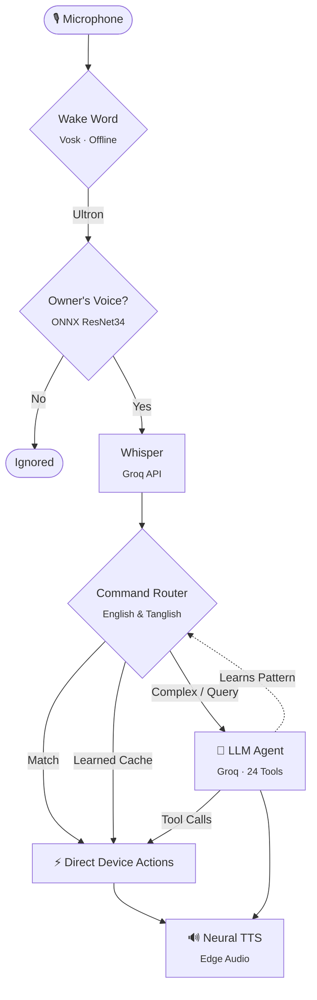

<div align="center">


<br>

[](https://github.com/n1dlee/friday-mobile/releases)
[](https://github.com/n1dlee/friday-mobile/actions/workflows/ci.yml)
[](LICENSE)

[](#-installation)
[](https://kotlinlang.org)
[](https://developer.android.com/jetpack/compose)
[](https://groq.com)
[](https://onnxruntime.ai)

<br>

*Say "Ultron". He answers — with ruthless precision and unmatched capability.*

<br>

</div>

---

**ULTRON** is an intelligent, autonomous hands-free personal AI assistant for Android. Designed with a striking dark red and obsidian tactical aesthetic, Ultron operates with speed and precision. He listens exclusively to his owner's verified voice, carries out everyday device operations offline in milliseconds, and leverages a high-performance LLM agent with tools for complex reasoning.

Ultron natively supports **English** and **Tanglish** (Tamil-English transliteration).

> [!NOTE]
> Ultron requires a free [Groq API key](https://console.groq.com/keys) and a 64-bit Android device (Android 8.0+).

---

## ✨ Highlights

<table>
<tr>
<td width="50%" valign="top">

### 🎙️ Silent Wake Word
Offline keyword spotting using [Vosk](https://alphacephei.com/vosk/) with grammar-constrained decoding. No audio leaves your phone until you say **"Ultron"** or **"Hey Ultron"**.

### 🔐 Biometric Speaker Verification
An on-device ResNet34 speaker verification model (wespeaker, ONNX Runtime) validates both the wake word and the command against your enrolled voice vector. Strangers and background noise are strictly ignored.

### ⚡ Dual-Tier Intelligence
Over 40 everyday commands run directly on the phone in milliseconds without touching the network. Everything else escalates to a tool-augmented LLM agent.

</td>
<td width="50%" valign="top">

### 🗣️ English & Tanglish Fluency
Understands and responds fluently in both English and Tanglish (e.g. *"Ultron, torch podu"*, *"Climate epdi irukku?"*, *"Phone pannu dad-ku"*).

### 🧭 Intelligent Comm Routing
"Text Mom" automatically chooses between SMS, WhatsApp, or Telegram based on international country codes and installed apps. "Call Dad abroad" shifts seamlessly to a WhatsApp call.

### 💬 Chat Monitoring & Hands-Free Replies
Monitors incoming messages from WhatsApp, Telegram, and SMS quietly. Ask *"Any unread messages?"* to hear who messaged; reply hands-free directly through notifications.

### 🌐 Live Information & Calculations
Fetches real-time web search via Groq, accurate weather forecasts from [Open-Meteo](https://open-meteo.com), and offloads arithmetic to an exact local calculator.

### 🔌 Public APIs Search (GitHub `public-apis`)
Ultron integrates the entire free [public-apis/public-apis](https://github.com/public-apis/public-apis) catalog. Ask *"Find weather APIs"*, *"Search cryptocurrency APIs"*, or *"Find an API for anime"*, and Ultron looks up matching public APIs, endpoint URLs, authentication requirements, HTTPS, and CORS support.

### 📄 iLovePDF Automation (`ilovepdf.com`)
Automates document operations via [iLovePDF](https://www.ilovepdf.com/). Ultron triggers actions including:
- **Merge PDF**, **Split PDF**, **Compress PDF**
- **PDF to Word**, **Word to PDF**, **PDF to JPG**, **JPG to PDF**
- **PDF to Excel**, **PDF to PowerPoint**
- **Watermark**, **Rotate**, **Unlock**, and **Protect PDF**
- **Sign PDF** and **Organize PDF**
Say: *"Merge my PDFs"*, *"Compress this PDF"*, *"Convert PDF to Word"*, or *"Sign PDF"*.

</td>
</tr>
</table>

---

## 🗣️ Try Saying

| You say | Ultron |
|---|---|
| *"Ultron… set an alarm for 7:30 and tell Mom I'll be late"* | Sets the alarm and drafts the WhatsApp message to Mom |
| *"Call Dad"* / *"Dad-ku phone pannu"* | Places direct cellular or WhatsApp call based on location |
| *"What did Mom write?"* → *"Reply: I am on my way"* → *"Yes"* | Reads incoming chat, reads back your draft, and sends it |
| *"Play Believer on Spotify"* · *"Paatu stop pannu"* | Controls media playback and now-playing status |
| *"Volume to 50"* · *"Torch podu"* · *"Open Bluetooth"* | Executes instantly on-device with zero latency |
| *"Time enna aachu?"* / *"What time is it?"* | Reports exact time instantly |
| *"Weather epdi irukku tomorrow?"* / *"Weather in Chennai"* | Fetches real-time forecast from Open-Meteo |
| *"Create rest mode: silent, DND, lowest brightness"* | Automates device states into a custom callable mode |
| *"Remind me tomorrow at 9 to call the doctor"* | Creates a calendar event with an alarm reminder |

---

## 🧠 Architecture Flow



- **Offline First:** Common actions never ping the model, saving battery, tokens, and time.
- **Tool Honesty:** The agent may only act through tools and must accurately reflect execution outcomes.
- **Deep Red Aesthetic:** Complete UI themed in dark obsidian and crimson red, mirroring Ultron's visual signature.

---

## 📥 Installation & Setup

1. Download the latest **`Ultron.apk`** from [Releases](https://github.com/n1dlee/friday-mobile/releases/latest) and install it on your device.
2. Open **Settings** in Ultron:
   - Enter your free **Groq API key** ([console.groq.com/keys](https://console.groq.com/keys));
   - Download the offline voice model (~40 MB) and enable **Wake Word**;
   - Record your voice profile (8 calibration phrases, ~1 minute).
3. Grant permissions as prompted: Microphone, Overlay, Notifications, Contacts, and Location.
4. Say **"Ultron"** or **"Hey Ultron"**.

---

## 🔐 Privacy & Security

* **Zero recording before the wake word:** Keyword detection runs 100% locally and offline.
* **On-device biometrics:** Your voice profile is a 256-dimensional numerical vector stored exclusively on your device.
* **Transient chat data:** Conversations and notifications are processed in-memory and never sent to third-party databases.
* **Keystore encryption:** All user secrets and API keys are encrypted via Android Keystore.

---

## 🛠️ Tech Stack

| Component | Technology |
|---|---|
| **UI** | Kotlin 2.1, Jetpack Compose, Material 3, Dark Red / Obsidian Theme |
| **Architecture** | Clean Architecture, MVVM + StateFlow, Koin DI |
| **Local Storage** | Room Database, EncryptedSharedPreferences, WorkManager |
| **Wake Word Engine** | Vosk (`vosk-model-small-en-us-0.15`), grammar-constrained decoding |
| **Biometric Voice ID** | wespeaker ResNet34 ONNX Runtime, Kotlin Kaldi fbank |
| **STT** | Whisper large-v3-turbo via Groq |
| **LLM Agent** | Groq streaming tool execution (`openai/gpt-oss-120b` / `20b`) |
| **TTS** | Microsoft Edge Neural Voices (`en-US-ChristopherNeural` & `en-IN-PrabhatNeural`) |
| **Testing** | 88 test suites (600+ unit tests with JUnit, MockK, Turbine, Robolectric) |

---

## 🔨 Building The APK

### Option A: One-Click Build Script (Windows)
Double-click `build_apk.bat` in the project root:
```cmd
build_apk.bat
```
It auto-detects your JDK 17, launches Gradle, and outputs:
```
app\build\outputs\apk\debug\app-debug.apk
```

### Option B: Automated Cloud Build (GitHub Actions)
Push the code or fork this repository on GitHub. The pre-configured GitHub Actions workflow (`.github/workflows/build.yml`) builds the APK in ~2 minutes and makes `Ultron-Debug-APK` downloadable directly under the **Actions** tab.

### Option C: Command Line
Prerequisites: **JDK 17 or 21**, Android SDK 35.

```bash
git clone https://github.com/n1dlee/friday-mobile.git
cd friday-mobile
./gradlew assembleDebug          # APK generated in app/build/outputs/apk/debug/
./gradlew assembleRelease        # Minified with R8, in app/build/outputs/apk/release/
./gradlew testDebugUnitTest      # Run unit test suite
./gradlew detekt                 # Static code analysis
```

---

## 📄 License

Released under the [MIT License](LICENSE).

<div align="center">
<sub>Engineered with precision. All systems operational.</sub>
</div>
