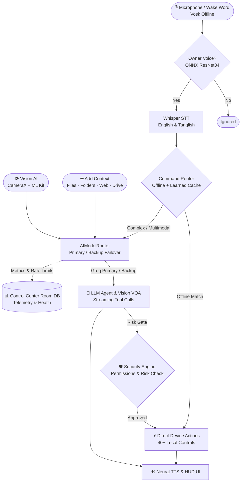

<div align="center">


<br>

[](https://github.com/Nadesh-001/ULTRON/releases/latest)
[](https://github.com/Nadesh-001/ULTRON/actions/workflows/android-build.yml)
[](https://github.com/Nadesh-001/ULTRON/actions/workflows/android-health-check.yml)
[](LICENSE)

[-3DDC84?style=flat-square&logo=android&logoColor=white)](#-installation--setup)
[](https://kotlinlang.org)
[](https://developer.android.com/jetpack/compose)
[](https://groq.com)
[](#-ultron-vision-ai)
[](https://onnxruntime.ai)

<br>

*Say "Ultron". He sees, listens, verifies your voice, routes AI models with automatic failover, and commands your Android device with ruthless precision.*

<br>

**[⬇️ Download Latest APK (v0.21.0)](https://github.com/Nadesh-001/ULTRON/releases/download/v0.21.0/Ultron-v0.21.0-debug.apk)** · **[📋 Release Notes](https://github.com/Nadesh-001/ULTRON/releases/tag/v0.21.0)** · **[📜 Changelog](CHANGELOG.md)** · **[🏗️ Full Architecture](docs/PROJECT_ARCHITECTURE.md)**

</div>

---

**ULTRON** (`com.ultron.ai`) is an autonomous, hands-free personal AI assistant and multimodal control system for Android. Engineered in **Kotlin 2.1.0** and **Jetpack Compose (Material 3)** with a dark obsidian and crimson metallic HUD (`#050505` / `#101216` / `#FF3030`), ULTRON combines offline wake-word detection, on-device biometric speaker verification, a Google Lens-inspired **Vision AI** suite, an **AI Control Center** with multi-model failover routing, a **Security & Permission Engine**, and **English + Tanglish** natural voice control.

> [!NOTE]
> ULTRON requires a free [Groq API key](https://console.groq.com/keys) and a 64-bit (`arm64-v8a`) Android device running **Android 8.0 (API 26) or higher**. API keys are entered in Settings and stored locally via Android Keystore — never hardcoded in the APK.

---

## 🚀 What's New in v0.21.0

- **🎛️ ULTRON AI Control Center** — Live connection status, local token & request telemetry, RPM/TPM rate-limit monitors, usage analytics & charts, Model Manager with verified capability badges, Model Health Monitor, and intelligent `AIModelRouter` with automatic backup failover.
- **👁️ ULTRON Vision AI** — Google Lens-inspired CameraX viewfinder with 6 specialized visual intelligence modes (Object Recognition, OCR Text, Live Translation, Math & Homework Solver, QR/Barcode Scanner, Document Intelligence) plus multi-turn Visual Question Answering (VQA).
- **🛡️ Centralized Security & Permission Architecture** — Unified Security Dashboard, 14 runtime permissions + 5 special privileges, Keystore AES-256 vault, tri-level AI risk authorization, and hardware kill switches.
- **🖥️ Dark-Metallic Home Dashboard & Voice Assistant HUD** — Cinematic `UltronHomeDashboard` and kinetic waveform `UltronVoiceAssistantScreen` with enforced English/Tanglish Whisper speech recognition.
- **➕ Add Context & Tool Integration** — Popup context composer supporting Storage Access Framework (SAF) files, directory analysis, `@` mentions, predefined actions, web page extraction, and Google Drive.
- **✅ Verified Automated CI/CD & QA** — Dual GitHub Actions pipelines compiling `Ultron-v0.21.0-debug.apk`, running 91 unit test suites, Android Lint, Detekt, secret scanning, and automatic GitHub Releases.

---

## ✨ Core Capabilities

<table>
<tr>
<td width="50%" valign="top">

### 🎛️ ULTRON AI Control Center
- **Overview Dashboard:** Live Groq & backup provider connection status, average latency, 24h local token cards, RPM/TPM rate-limit progress bars, and active role assignments.
- **Usage & Analytics:** Locally tracked request counts, input/output/total tokens, timeframe filters (`Today`, `7d`, `30d`, custom), model-wise breakdown, error frequency, and strict billing transparency (*never fabricates credits or account balance*).
- **Model Manager:** Configurable Primary, Backup, Vision, Voice, Lightweight, and Reasoning models with verified capability badges (`TEXT`, `VISION`, `TOOL CALLING`, `REASONING`, `AUDIO`, `STREAMING`) and confirmation prompts before changing the primary model.
- **Intelligent Failover (`AIModelRouter`):** Automatic retry and backup routing on recoverable failures (`HTTP 429`, `502/503/504`, network timeout) with health monitoring.

### 👁️ ULTRON Vision AI
- **Live CameraX Viewfinder:** Cybernetic HUD reticle brackets, flash toggle, front/rear lens switching, gallery picker, and EXIF-aware image normalization.
- **6 Specialized Modes:** Object Recognition, OCR Text Extraction (ML Kit), Live Translation & Language ID, Math & Homework Solver, QR/Barcode Scanner (ML Kit), and Document Intelligence.
- **Multi-Turn Visual Q&A:** Keeps visual context alive across follow-up questions with quick prompt chips.

### 🛡️ Security & Privacy Engine
- **Security Dashboard:** Centralized view of 14 runtime permissions, 5 special Android privileges (Overlay, Notification Listener, Accessibility, DND, Exact Alarms), and system posture.
- **Zero-Leak Storage:** API keys and secrets encrypted via Android Keystore (`AES-256`); automated CI secret scanning blocks leaked credentials.
- **AI Risk Authorization & Kill Switches:** Tri-level risk confirmation for sensitive device actions plus instant hardware/automation kill switches.

</td>
<td width="50%" valign="top">

### 🎙️ Voice Engine & Biometric ID
- **Offline Wake Word:** Local grammar-constrained [Vosk](https://alphacephei.com/vosk/) spotting — zero audio leaves the phone until you say **"Ultron"** or **"Hey Ultron"**.
- **Biometric Speaker Verification:** On-device wespeaker ResNet34 (`ONNX Runtime 1.20.0`) validates your 256-D voiceprint against strangers and background noise.
- **English & Tanglish Fluency:** Enforced English & Tamil-English transliteration via Groq Whisper (`large-v3-turbo`) and Microsoft Edge Neural TTS.

### ➕ Add Context & Productivity
- **Universal `(+)` Context Picker:** Attach files (SAF), analyze folders (`ACTION_OPEN_DOCUMENT_TREE`), invoke `@` mentions, run predefined actions, extract live web content, or pull from Google Drive.
- **Smart Communications:** Automatically routes messages and calls across SMS, WhatsApp, Telegram, or cellular based on country codes (`libphonenumber`) and installed apps, plus hands-free notification replies and Gmail integration.
- **Modes, Schedules & Briefings:** Custom device automation profiles, scheduled alarms/reminders, and WorkManager morning briefings.

### 🌐 Live Tools & Automations
- **Dual-Tier Execution:** 40+ device actions run offline in milliseconds; complex queries escalate to the streaming tool-calling LLM agent.
- **Real-Time Web & Weather:** Live web search, exact local math evaluation, and [Open-Meteo](https://open-meteo.com) forecasts.
- **Public APIs & iLovePDF:** Built-in search across the `public-apis` catalog and document automation workflows (Merge, Split, Compress, Convert, Sign, Protect PDFs).

</td>
</tr>
</table>

---

## 🗣️ Example Voice Commands

| You say | ULTRON executes |
|---|---|
| *"Ultron… set an alarm for 7:30 and tell Mom I'll be late"* | Creates the alarm and drafts the WhatsApp message to Mom |
| *"Call Dad"* / *"Dad-ku phone pannu"* | Places direct cellular or WhatsApp call based on country code |
| *"What did Mom write?"* → *"Reply: I am on my way"* → *"Yes"* | Reads incoming chat, confirms your reply, and sends hands-free |
| *"Play Believer on Spotify"* · *"Paatu stop pannu"* | Controls media playback and reports now-playing status |
| *"Volume to 50"* · *"Torch podu"* · *"Open Bluetooth"* | Executes instantly on-device with zero network latency |
| *"Weather epdi irukku tomorrow?"* / *"Weather in Chennai"* | Fetches live forecast from Open-Meteo |
| *"Create rest mode: silent, DND, lowest brightness"* | Saves and triggers a reusable custom device automation mode |
| *"Remind me tomorrow at 9 to call the doctor"* | Schedules calendar reminder with exact notification timing |

---

## 🧠 System Architecture



For the full package map and module breakdown, see **[docs/PROJECT_ARCHITECTURE.md](docs/PROJECT_ARCHITECTURE.md)**.

---

## 📂 Project Structure

**317 Kotlin source files** (`app/src/main/java`) · **91 unit test suites** (`app/src/test/java`)

```text
ULTRON/
├── .github/workflows/
│   ├── android-build.yml           # Builds Ultron-v0.21.0-debug.apk & publishes GitHub Release
│   └── android-health-check.yml    # Secret scan, clean build, unit tests, lint, detekt & QA report
├── app/src/main/java/com/ultron/ai/
│   ├── agent/                      # Streaming LLM agent, tool registry & orchestration
│   ├── command/                    # Offline command router & natural language matchers
│   ├── controlcenter/              # AI Control Center (router, failover, health, telemetry, Room DB, UI)
│   ├── core/                       # Audio, voice, apps, context (+), mail, messages, modes, PDF, people, capabilities
│   ├── data/                       # Repositories, Room DB, Retrofit/OkHttp DTOs, Keystore secure vault, backups
│   ├── di/                         # Koin 4.0 dependency injection modules
│   ├── domain/                     # Clean domain models, repository interfaces & use cases
│   ├── service/                    # Wake-word foreground service, notification listener, WorkManager workers
│   ├── ui/                         # Compose screens (Dashboard, Voice, Chat, Security, Modes, Notebook, Diagnostics, Settings)
│   └── vision/                     # CameraX controller, ML Kit OCR/Barcode/Translate, ImageProcessor & Vision VQA UI
├── app/src/test/java/              # 91 JUnit/MockK/Turbine/Robolectric test suites
├── config/detekt/                  # Detekt rules & baseline
├── docs/                           # Architecture docs, banner/icon SVGs, screen previews
├── keystore/                       # Local signing guide (keys strictly gitignored)
├── build_apk.bat                   # Windows one-click debug APK build helper
├── CHANGELOG.md                    # Complete version release history
└── README.md
```

---

## 📥 Installation & Setup

1. **Download the APK:** Grab **[Ultron-v0.21.0-debug.apk](https://github.com/Nadesh-001/ULTRON/releases/download/v0.21.0/Ultron-v0.21.0-debug.apk)** from the [Releases page](https://github.com/Nadesh-001/ULTRON/releases/latest) and install it on your 64-bit Android 8.0+ device.
2. **Configure API & Models:** Open **Settings** (or **AI Control Center**) and enter your free [Groq API key](https://console.groq.com/keys). Optionally configure a backup provider and customize Primary, Backup, Vision, and Voice models.
3. **Set Up Wake Word & Voice ID:** Download the offline Vosk voice model (~40 MB), enable **Wake Word**, and record your 8-phrase voice calibration profile.
4. **Review Permissions:** Open the **Security Dashboard** to inspect and grant only the permissions you want (Microphone, Camera, Overlay, Notifications, Contacts, Location, etc.).
5. **Activate:** Say **"Ultron"**, tap the Voice Orb, or launch **Vision** from the HUD.

---

## 🛠️ Tech Stack

| Layer | Technologies & Versions |
|---|---|
| **Language & Build** | Kotlin `2.1.0`, Android Gradle Plugin `8.12.3`, Gradle `8.13`, KSP `2.1.0-1.0.29`, JDK 17 |
| **Android Target** | `compileSdk 35`, `targetSdk 35`, `minSdk 26` (Android 8.0+), `arm64-v8a` |
| **UI & Navigation** | Jetpack Compose BOM `2024.12.01`, Material 3, Material Icons Extended, Navigation Compose `2.8.5` |
| **Architecture & DI** | Clean Architecture, MVVM + `StateFlow`, Koin `4.0.0`, Coroutines `1.9.0` |
| **Local Persistence** | Room `2.6.1`, Android Keystore AES-256 Vault, WorkManager `2.9.1` |
| **Networking** | Retrofit `2.11.0`, OkHttp `4.12.0`, `kotlinx-serialization-json 1.7.3` |
| **Voice & Biometrics** | Vosk `0.3.47` (offline wake word), ONNX Runtime `1.20.0` (wespeaker ResNet34), Groq Whisper, Edge Neural TTS |
| **Vision AI** | CameraX `1.4.1`, ML Kit Text Recognition `16.0.1`, Barcode Scanning `17.3.0`, Language ID `17.0.6`, ExifInterface `1.3.7` |
| **Communications** | Google Play Services Auth `21.6.0` (Gmail), `libphonenumber 8.13.52` |
| **Testing & Quality** | 91 test suites (JUnit `4.13.2`, MockK `1.13.13`, Turbine `1.2.0`, Robolectric `4.14.1`), Android Lint, Detekt `1.23.8` |

---

## 🔨 Building from Source

### Prerequisites
- **JDK 17** (Eclipse Temurin recommended)
- **Android SDK Platform 35** & Build-Tools `35.0.0`

### Option A: Automated Cloud Build (GitHub Actions)
Every push to `main` automatically runs two workflows:
- **[Android Build & Quality Validation](.github/workflows/android-build.yml)** — Compiles `Ultron-v0.21.0-debug.apk`, uploads the build artifact, and publishes it to [GitHub Releases](https://github.com/Nadesh-001/ULTRON/releases).
- **[Android Health Check & Build QA Pipeline](.github/workflows/android-health-check.yml)** — Runs secret leak scanning, clean compilation, unit tests, Android Lint, Detekt static analysis, APK verification, and generates a QA health report.

### Option B: Command Line
```bash
git clone https://github.com/Nadesh-001/ULTRON.git
cd ULTRON
./gradlew assembleDebug          # Output: app/build/outputs/apk/debug/Ultron-v0.21.0-debug.apk
./gradlew testDebugUnitTest      # Run all 91 unit test suites
./gradlew lintDebug              # Run Android Lint checks
./gradlew detekt                 # Run Detekt static code analysis
./gradlew ownerRelease           # Owner-signed R8-minified release APK (see keystore/README.md)
```

### Option C: Windows Helper Script
```cmd
build_apk.bat
```

---

## 🔐 Security Policy

- **No Secrets in Git:** `local.properties`, `.env*`, `*.keystore`, `*.jks`, and `google-services.json` are strictly gitignored and enforced by CI secret scanning.
- **Local-First Audio & Biometrics:** Wake-word spotting and 256-D speaker verification run 100% on-device.
- **Release Signing:** See [keystore/README.md](keystore/README.md) for setting up `ULTRON.keystore` via `local.properties` or CI secrets.

---

## 📄 License

Released under the [MIT License](LICENSE).

<div align="center">
<sub>ULTRON v0.21.0 · Engineered with precision. All systems operational.</sub>
</div>
